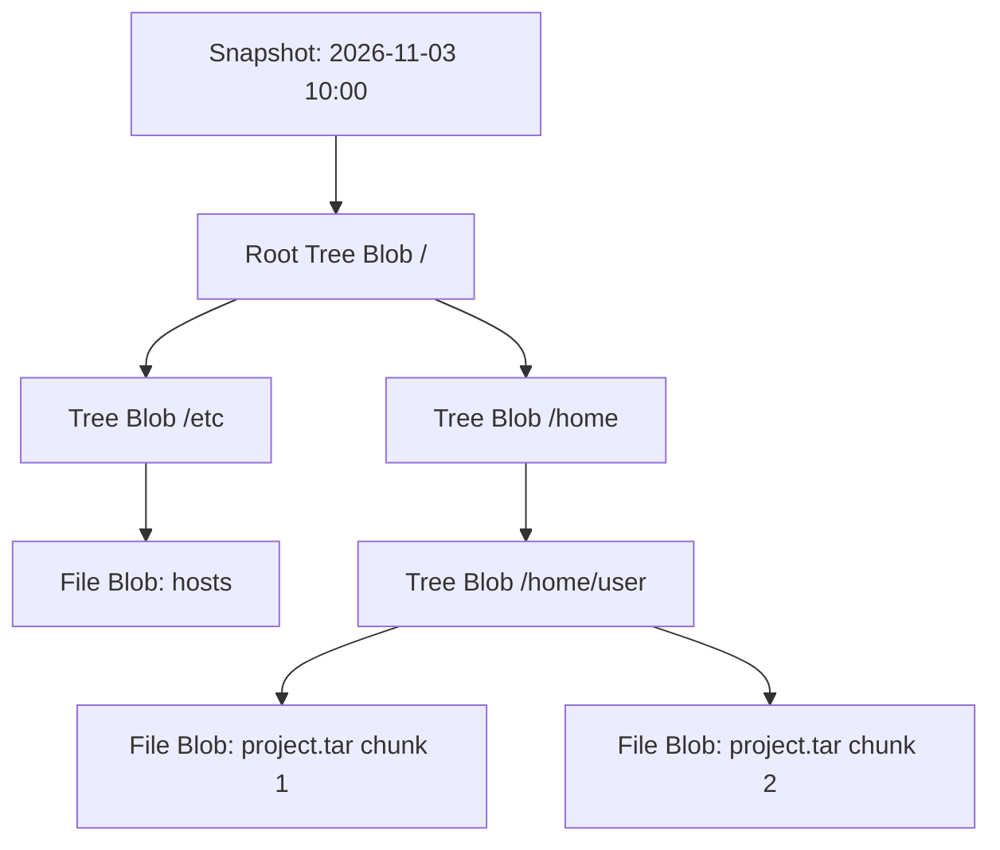

<span class="topic-badge badge-concept">Concept</span>

# Repository Architecture & Cryptographic Design

This topic explains how Restic organizes and secures backed-up data on physical storage. Understanding this architecture allows system administrators to design resilient backup topologies, configure appropriate storage tiers, and troubleshoot repository lock states.

---

## Zero-Trust Cryptographic Model

Restic assumes that the target storage medium (local disk, cloud bucket, or remote server) is an untrusted environment. Consequently, **all data stored in a repository is encrypted at rest and authenticated prior to ingestion**.


### Cryptographic Primitives

Restic leverages the following cryptographic algorithms:

| Layer | Algorithm / Standard | Purpose |
| :--- | :--- | :--- |
| **Master Key Protection** | `scrypt` (KDF) | Derives repository encryption keys from user passwords with high memory-cost work factors. |
| **Data Encryption** | `AES-256-CTR` | Encrypts all blob payloads (both data and directory trees) with unique initialization vectors (IVs). |
| **Message Authentication** | `Poly1305-AES` | Protects every blob and packfile against bit-rot, corruption, and active ciphertext tampering. |
| **Blob Hashing** | `SHA-256` | Computes unique, deterministic identifiers for every data chunk prior to encryption. |

---

## Physical Repository Layout

When Restic initializes a repository (via local path or S3 bucket), it establishes an immutable directory tree:

```
my-backup-repo/
├── config              # Master repository configuration (JSON format, encrypted)
├── keys/               # User password envelopes (allows multiple passwords)
│   └── 3f8b9a2c...
├── snapshots/          # Snapshot descriptor files (JSON format, encrypted)
│   └── 8a24c1e0...
├── index/              # Index files mapping Blob IDs to Pack Files and offsets
│   └── 1d9e7a8f...
├── data/               # Pack files containing combined encrypted data blobs
│   ├── 0a/
│   │   └── 0a1b2c3d...
│   └── ff/
│       └── ff9e8d7c...
└── locks/              # Ephemeral lock files managing concurrent read/write leases
    └── e2b4a56c...
```

### Structural Components

### 1. `config`
The root file containing the repository format version (v1 or v2), chunker parameters (min, max, and average chunk size), and unique repository UUID. Encrypted with the master key.

### 2. `keys/`
Restic supports multiple concurrent passwords. Each key file in `keys/` contains the master repository key encrypted with a distinct password's scrypt-derived key. Adding or revoking a password does **not** re-encrypt the stored data files.

### 3. `snapshots/`
A snapshot represents a point-in-time state of an individual backup run. It records:
- Creation timestamp and host system hostname
- Backup tags and user paths
- Root tree blob ID pointing to the directory hierarchy

### 4. `data/` (Pack Files)
To prevent creating millions of small files on filesystem or S3 backends, Restic batches individual data blobs into **pack files** (typically 4 MB to 16 MB in size). A pack file contains:
- Encrypted data blobs
- A pack header listing blob SHA-256 hashes, encrypted lengths, and compression types

### 5. `index/`
Index files serve as the lookup index for the entire repository. When Restic queries a blob by its SHA-256 hash, the index specifies which pack file contains that blob and the exact byte offset.

### 6. `locks/`
Restic manages concurrency using transient lease files stored in `locks/`. Two types of locks exist:
- **Exclusive Lock (`write`)**: Required during index rebuilds, repository optimization, and `prune` cycles.
- **Shared Lock (`read`)**: Permitted during concurrent backup operations, snapshot restores, and dry-run checks.

---

## Data Model: Trees and Blobs

Restic models files and directories in a directed acyclic graph (DAG) similar to Git:



1. **Blob**: An encrypted chunk of binary content (either raw file content or serialized directory listings).
2. **Tree**: A special blob containing an array of directory entries (filenames, permissions, timestamps, extended attributes, and blob references).
3. **Snapshot**: The root pointer capturing the root tree at an instantaneous timestamp.

---

## Related Topics

- [Deduplication Mechanics](deduplication.md) — Learn how Rabin fingerprints eliminate redundant chunks.
- [Retention & Pruning Lifecycle](retention-and-pruning.md) — Understand how snapshots are aged out and pack files repacked.
- [Initialize a Repository](../tasks/initialize-repository.md) — Provision your first encrypted repository.
