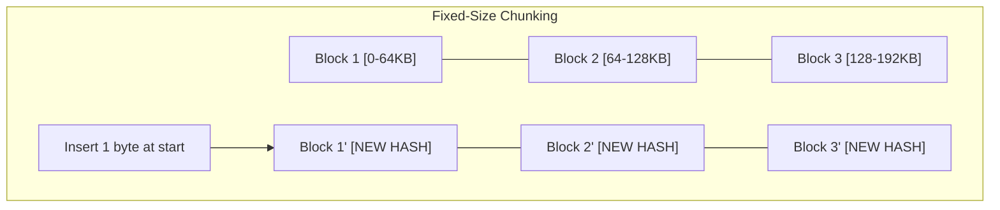
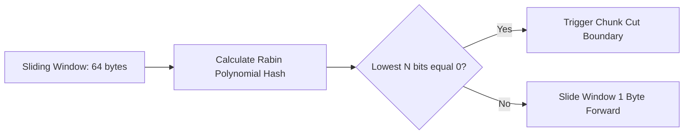
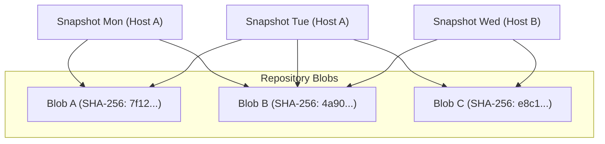

<span class="topic-badge badge-concept">Concept</span>

# Deduplication Mechanics & Content-Defined Chunking

This topic details the algorithmic foundation of Restic's storage efficiency: **Content-Defined Chunking (CDC)** powered by **Rabin fingerprints**. Understanding this mechanism enables operators to predict backup durations, optimize storage capacity, and structure backup jobs for maximum deduplication efficiency.

---

## Why Content-Defined Chunking?

Traditional backup systems often employ **fixed-size block chunking** (e.g., dividing files every 4 KB or 64 KB). While simple, fixed-size chunking suffers from the **boundary-shift problem**:



If a user inserts a single byte at the beginning of a file, every subsequent block boundary shifts. Consequently, all chunk hashes change, forcing the backup tool to re-upload and re-store the entire file despite 99.99% identical content.

### Content-Defined Chunking (CDC) Solution

Restic resolves this by letting the **data content determine the chunk boundary**. Boundaries are defined dynamically by computing a rolling checksum over a sliding window across the file.



When the lower bits of the rolling Rabin fingerprint match a predefined bitmask, Restic marks a boundary cut. If bytes are inserted or deleted earlier in the file, only the immediate chunk changes. All preceding and subsequent chunk boundaries remain invariant, preserving deduplication across versions.

---

## The Rabin Fingerprint Parameters

Restic configures the chunker with target minimum, maximum, and average sizes:

| Parameter | Default Value | Purpose |
| :--- | :--- | :--- |
| **Minimum Chunk Size** | `512 KiB` | Prevents pathological fragmentation from high-entropy data. |
| **Target Average Chunk Size** | `1 MiB` | Optimizes the ratio between deduplication granularity and metadata index size. |
| **Maximum Chunk Size** | `8 MiB` | Prevents oversized single blobs when processing low-entropy streams. |

### Chunk Hashing and Identification

Once a chunk boundary is cut:
1. Restic computes the **SHA-256** hash of the plaintext chunk.
2. The SHA-256 hash serves as the chunk's global unique identifier (Blob ID).
3. Restic checks its local memory index to determine if the Blob ID already exists in the repository.
4. If the blob already exists, Restic increments reference counters and skips reading, encrypting, or uploading the chunk.
5. If the blob is new, it is encrypted with AES-256-CTR and queued for upload into a pack file.

---

## Cross-File and Cross-Snapshot Deduplication

Restic's deduplication is **global across the entire repository**:

- **Cross-Snapshot**: Successive backups of the same directory only upload the net delta. Unchanged files require zero transfer.
- **Cross-Path**: If `/var/www/site1/app.jar` is duplicated to `/home/dev/backup/app.jar`, it is stored exactly once.
- **Cross-Host**: If multiple database servers back up identical binary packages to the same Restic repository, the identical blocks are shared across host boundaries.



---

## Storage Savings Estimation

To inspect real-world deduplication savings in your repository, run:

```bash
restic stats --mode raw-data
```

Sample output:

```text
scanning...
Stats in raw-data mode:
  Snapshots processed:   148
  Total File Count:      428,190
  Total Uncompressed Size: 1.420 TiB
  Total Stored Size:     38.412 GiB
  Compression Ratio:     1.82x
  Deduplication Factor:  37.8x
```

In this real-world production workload, 148 daily snapshots representing 1.42 TiB of cumulative file data occupy only 38.4 GiB of actual repository storage.

---

## Related Topics

- [Repository Architecture](architecture.md) — How pack files encapsulate deduplicated blobs.
- [Create Backups](../tasks/create-backups.md) — Step-by-step procedure for executing deduplicated backups.
- [Prune & Enforce Retention](../tasks/prune-snapshots.md) — Safely garbage-collect unreferenced blobs.
