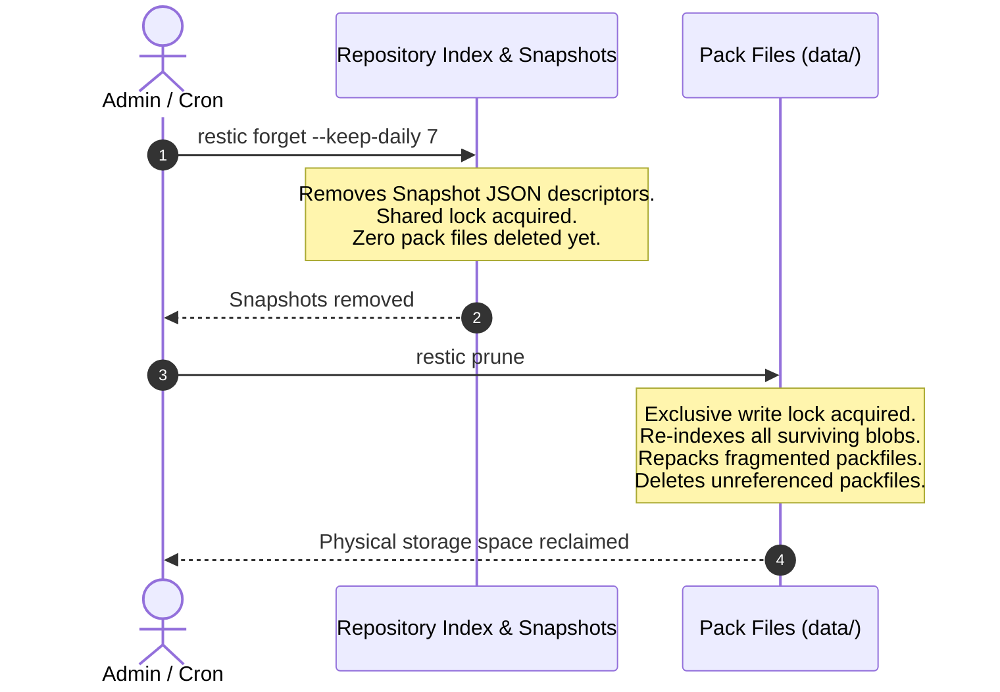
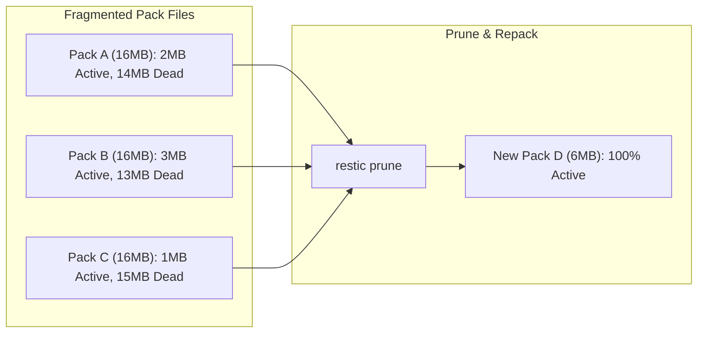

<span class="topic-badge badge-concept">Concept</span>

# Snapshot Retention & Pruning Lifecycle

This topic explains how Restic manages the data lifecycle: evaluating retention rules, distinguishing between the `forget` and `prune` phases, repacking partially used pack files, and acquiring repository lock leases.

---

## The Two-Stage Cleanup Architecture

Many backup tools conflate deleting a snapshot with immediate disk space reclamation. Restic decouples this into two distinct, deterministic phases to maximize safety and permit concurrent operations:



### Stage 1: `forget` (Logical Dereferencing)
The `forget` command evaluates retention criteria (such as `--keep-daily 7` or `--keep-weekly 4`). It deletes only the designated **snapshot descriptor files** located in `snapshots/`.

- **Lock requirement**: Shared read lock. Other backup or restore processes can continue simultaneously.
- **Physical disk space**: Remains unchanged. All data blobs and pack files referenced by the deleted snapshot remain intact on storage in case they are still shared by surviving snapshots.

### Stage 2: `prune` (Physical Garbage Collection)
The `prune` command performs comprehensive garbage collection across the repository:
1. **Blob Reference Tracing**: Traverses all existing snapshot descriptors to build a master graph of every actively referenced blob ID.
2. **Identification of Orphaned Blobs**: Identifies blobs in `data/` that are no longer reachable from any snapshot.
3. **Pack Repacking**: If a pack file contains both active and orphaned blobs, Restic downloads the active blobs, writes them into a new consolidated pack file, updates the index, and deletes the old pack file.
4. **Physical Deletion**: Deletes pure orphaned pack files from storage, freeing storage quota.

---

## Retention Policy Rules

Restic applies retention rules independently per host, path, and tag. When defining rules, policies act as **inclusive filters**:

| Retention Flag | Meaning |
| :--- | :--- |
| `--keep-last N` | Keeps the most recent `N` snapshots. |
| `--keep-hourly N` | Keeps the newest snapshot for each of the last `N` distinct hours that have a snapshot. |
| `--keep-daily N` | Keeps the newest snapshot for each of the last `N` distinct calendar days. |
| `--keep-weekly N` | Keeps the newest snapshot for each of the last `N` distinct ISO weeks. |
| `--keep-monthly N` | Keeps the newest snapshot for each of the last `N` distinct calendar months. |
| `--keep-yearly N` | Keeps the newest snapshot for each of the last `N` distinct years. |
| `--keep-tag TAG` | Keeps all snapshots with the specified tag, regardless of age. |

> [!IMPORTANT]
> Restic evaluates time retention rules by **grouping**. If you execute 10 backups in a single day, `--keep-daily 7` will keep only the single latest snapshot from that day, leaving 6 daily retention slots for prior days.

---

## Pack Repacking & Optimization

Over months of backup runs, data deletion creates sparse pack files. If a 16 MiB pack file contains only 2 MiB of active data, leaving it intact wastes storage and inflates the repository index.



Restic's prune algorithm features a threshold parameter: `--max-unused`. By default, Restic only repacks pack files if more than 5% of their bytes are unused, minimizing unnecessary cloud egress and write bandwidth.

---

## Repository Lock Concurrency

To ensure cryptographic and data integrity during multi-client operations, Restic creates atomic lock files in `locks/`:

```
locks/
├── 361e27a697b0a312...  # Exclusive lock: Restricts other writers
└── 9f41bc19e782a101...  # Shared lock: Allows parallel readers/writers
```

- **Stale locks**: If a backup worker terminates abruptly (e.g., kernel panic, spot instance termination), its lock file may remain on storage.
- **Lock timeouts**: Restic considers locks older than a configurable window eligible for manual or automated clearing via `restic unlock`.

---

## Related Topics

- [Prune & Enforce Retention](../tasks/prune-snapshots.md) — Step-by-step procedures for safely pruning snapshots.
- [Error Codes & Troubleshooting](../reference/error-troubleshooting.md) — How to resolve stale lock errors.
- [Repository Architecture](architecture.md) — The physical layout of `locks/` and `data/`.
