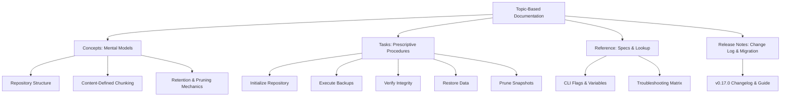

# Restic Documentation & Storage Architecture

Welcome to the topic-based technical documentation suite for **Restic**, a modern, secure, and deduplicating backup CLI designed for mission-critical infrastructure.

This documentation suite demonstrates a **topic-based information architecture (IA)** conforming to the Diátaxis and DITA principles. Content is divided strictly into four functional archetypes: **Concepts**, **Tasks**, **Reference**, and **Release Notes**.

---

## Information Architecture Overview

### 1. [Concepts](concepts/architecture.md)
*Focus: Understanding system behavior, data structures, and mental models.*

- [**Repository Architecture**](concepts/architecture.md): Cryptographic envelopes, pack files, tree blobs, and the zero-trust threat model.
- [**Deduplication Mechanics**](concepts/deduplication.md): Rabin fingerprinting, content-defined chunking, and rolling checksum optimization.
- [**Retention & Pruning Lifecycle**](concepts/retention-and-pruning.md): Separation between snapshot metadata deletion (`forget`) and physical garbage collection (`prune`).

### 2. [Tasks](tasks/initialize-repository.md)
*Focus: Goal-oriented, step-by-step procedures with explicit prerequisites, flags, and post-execution verification.*

- [**Initialize a Repository**](tasks/initialize-repository.md): Provision local storage, MinIO/S3 object stores, or SFTP targets with hardened key derivation.
- [**Create Backups**](tasks/create-backups.md): Execute incremental backups with exclusions, tags, and stdin stream piping.
- [**Verify Repository Integrity**](tasks/verify-integrity.md): Perform multi-tier integrity checks and bit-rot audits with `--read-data`.
- [**Restore Data**](tasks/restore-data.md): Retrieve selective files, restore full snapshots, or mount points via FUSE.
- [**Prune & Enforce Retention**](tasks/prune-snapshots.md): Automate snapshot pruning schedules while safely handling repository locks.

### 3. [Reference](reference/cli-cheat-sheet.md)
*Focus: Fast, authoritative lookups for operators, sysadmins, and automation engineers.*

- [**CLI Command Cheat Sheet**](reference/cli-cheat-sheet.md): Comprehensive matrix of commands, global flags, and environment variables.
- [**Error Codes & Troubleshooting**](reference/error-troubleshooting.md): Step-by-step diagnostic workflows for stale locks, index corruption, and credential failures.

### 4. [Release Notes](release-notes/v0-17-0.md)
*Focus: Transparent changelogs, breaking changes, and actionable upgrade procedures.*

- [**v0.17.0 Release Notes**](release-notes/v0-17-0.md): Major compression improvements, repository format v2 adoption, bug fixes, and deprecation notices.

---

## Technical Documentation Standards Applied

This documentation sample adheres to the following industry standards:

- **Active voice & imperative mood**: Instructions use direct, action-oriented verbs (e.g., *Run*, *Verify*, *Configure*).
- **Tested procedures**: Every CLI workflow in the Tasks section was tested directly against local and object-storage backends.
- **Fail-safe documentation**: Critical operations (e.g., repository pruning, key changes) include explicit warning admonitions and `--dry-run` verification steps.
- **Strict linting compliance**: Fully verified by custom doc linting rules covering Markdown structure, frontmatter schemas, and cross-reference validation.
