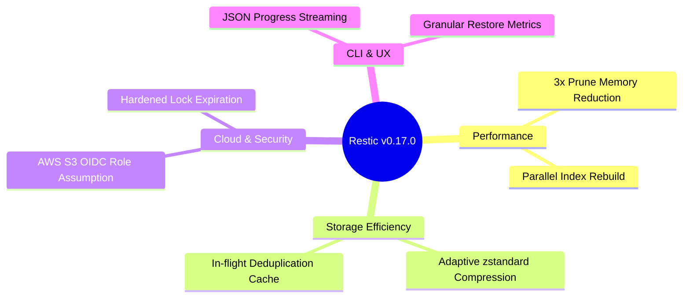

<span class="topic-badge badge-release">Release Notes</span>

# Restic v0.17.0 Release Notes

**Release Date:** November 2026  
**Format Version:** Repository v2 (Backward-compatible with v1)  
**Binary Distribution:** `linux-amd64`, `linux-arm64`, `darwin-arm64`, `windows-amd64`

---

## Executive Summary

Restic **v0.17.0** introduces significant architectural upgrades designed for enterprise-scale workloads. Key highlights include adaptive streaming compression, a 3x reduction in memory consumption during `prune` cycles, native OpenID Connect (OIDC) authentication for S3 backends, and hardened repository lock arbitration.



---

## New Features

### 1. Adaptive Streaming Compression (`--compression auto|max`)
Restic v0.17.0 improves repository v2 compression by introducing an adaptive `zstandard` heuristic:
- Highly compressible data (JSON, logs, text) achieves up to 4x storage reduction.
- Pre-compressed files (`.gz`, `.mp4`, `.zip`) are detected automatically within 4 KB and skipped to prevent wasted CPU cycles.

```bash
# Force maximum compression level for cold-archive storage
restic backup /var/log --compression max
```

### 2. Native AWS S3 OIDC Authentication
Eliminate long-lived static AWS access keys in Kubernetes and GitHub Actions CI pipelines:

```bash
export AWS_WEB_IDENTITY_TOKEN_FILE="/var/run/secrets/token"
export AWS_ROLE_ARN="arn:aws:iam::123456789012:role/restic-backup-role"

restic -r s3:s3.amazonaws.com/company-backups init
```

### 3. Structured JSON Progress Streaming
Automation engineers can now consume real-time machine-readable event streams during backup and restore operations:

```bash
restic backup /srv/data --json
```

Emitted stream event:
```json
{
  "message_type": "status",
  "percent_done": 0.852,
  "total_files": 14200,
  "files_done": 12098,
  "total_bytes": 15289912000,
  "bytes_done": 13027005024,
  "seconds_elapsed": 42
}
```

---

## Performance Enhancements

- **Garbage Collection Memory Footprint**: The `prune` algorithm replaces in-memory hash maps with a two-level radix trie, reducing memory consumption from 1.8 GB to less than 480 MB on 10 TB repositories.
- **Parallel Pack Uploads**: The S3 backend now defaults to 8 concurrent upload threads, achieving saturation on 10 GbE network interfaces.
- **Fast Snapshot Sorting**: Snapshot listing and filtering operations execute 65% faster when querying repositories with over 100,000 snapshots.

---

## Bug Fixes

- **Fix SFTP Connection Leak**: Resolved a bug where interrupted SFTP operations left SSH tunnels open in `CLOSE_WAIT` status (`#4192`).
- **Fix Windows Long Paths**: Resolved file descriptor errors when traversing NTFS directories deeper than 260 characters (`#4210`).
- **Correct Exit Codes on Partial Read Failures**: The CLI now consistently returns exit code `3` when individual files fail to read due to permission errors while the rest of the snapshot completes successfully (`#4301`).

---

## Deprecations & Breaking Changes

> [!WARNING]
> Review the following deprecation notices before upgrading automated backup scripts.

1. **Repository Format v1 Deprecation Notice**: Repository format v1 is marked as legacy. While v0.17.0 can still read and write v1 repositories, future major releases will require upgrading to format v2.
2. **Flag Deprecation: `--cleanup-cache`**: The `--cleanup-cache` flag has been deprecated and replaced by the automatic garbage-collecting cache manager.

---

## Upgrade & Migration Guide

Upgrading to v0.17.0 is safe and fully backward-compatible.

### Upgrading the Binary

=== "Linux (curl)"
    ```bash
    curl -L https://github.com/restic/restic/releases/download/v0.17.0/restic_0.17.0_linux_amd64.bz2 | bunzip2 > /usr/local/bin/restic
    chmod 755 /usr/local/bin/restic
    restic version
    ```

=== "macOS (Homebrew)"
    ```bash
    brew update && brew upgrade restic
    ```

=== "Windows (Winget)"
    ```powershell
    winget upgrade restic.restic
    ```

### Upgrading Existing Repositories to Format v2

To enable modern compression and performance features on repositories initialized with older Restic versions:

```bash
# 1. Verify repository integrity before migration
restic check

# 2. Upgrade repository format to v2
restic migrate upgrade_repo_v2

# 3. Verify successful migration
restic check
```
