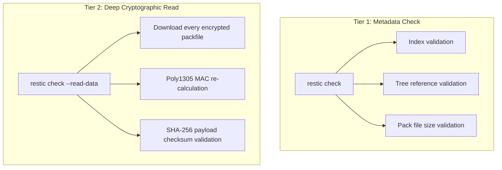

<span class="topic-badge badge-task">Task</span>

# Verify Repository Integrity & Detect Bit-Rot

This procedure details how to run systematic integrity checks against a Restic repository. Regular verification guarantees that indexes, pack headers, and encrypted data blobs are intact, catching storage media degradation and bit-rot before a critical disaster recovery restore is required.

---

## Prerequisites

- Read access to the target repository.
- Network bandwidth capacity proportional to the verification mode (standard metadata audit vs. full payload download).

---

## Verification Tiers

Restic offers two levels of verification:



---

## Step 1: Run Standard Metadata Verification (Weekly)

The standard check scans index structures, snapshot pointers, and structural references without reading entire data payloads. This is lightweight and fast:

```bash
restic check
```

Expected output:

```text
repository 82ef1a364b opened (version 2, compression level auto)
created new cache in /home/operator/.cache/restic
load indexes
check all packs
check snapshots, trees and blobs
[0:12] 100.00%  3,210 / 3,210 snapshots
no errors were found
```

If errors appear during index loading, proceed to the [Troubleshooting Matrix](../reference/error-troubleshooting.md#2-rebuilding-a-corrupted-index).

---

## Step 2: Run Cryptographic Bit-Rot Audit (`--read-data`)

To detect silent storage media corruption (bit-rot), execute a full read-check. Restic downloads each pack file, decrypts it, and confirms that the SHA-256 hash matches the index entry:

```bash
restic check --read-data
```

### Proportional Subsetting (Monthly Maintenance)

For large multi-terabyte repositories where downloading 100% of the repository is cost-prohibitive, verify a 10% random sample monthly using `--read-data-subset`:

```bash
# Checks 1/10th of the repository packs (shard 1 of 10)
restic check --read-data-subset=1/10
```

Subsequent runs can check shard `2/10`, `3/10`, etc., achieving 100% repository coverage over 10 consecutive cycles without spikes in cloud egress fees.

---

## Step 3: Automate Verification with Exit Code Alerting

Integrate verification into your operational monitoring using this bash script wrapper:

```bash title="/usr/local/bin/verify-restic.sh"
#!/usr/bin/env bash
set -euo pipefail

export RESTIC_REPOSITORY="/mnt/backups/restic-repo"
export RESTIC_PASSWORD_FILE="/etc/restic/password.txt"

echo "[$(date -Is)] Starting Restic integrity audit..."

if output=$(restic check 2>&1); then
    echo "[$(date -Is)] SUCCESS: Repository integrity verified."
    exit 0
else
    echo "[$(date -Is)] CRITICAL: Integrity check failed!"
    echo "${output}"
    # Trigger alerting webhook (e.g., Slack / PagerDuty)
    curl -X POST -H 'Content-type: application/json' \
      --data "{\"text\":\"Restic repository integrity failed at $(hostname): ${output}\"}" \
      "${ALERT_WEBHOOK_URL}"
    exit 1
fi
```

Make the script executable and schedule it via cron or systemd timer:

```bash
chmod +x /usr/local/bin/verify-restic.sh
```

---

## Next Steps

- [Restore Data](restore-data.md) — Practice recovering files from verified snapshots.
- [Prune & Enforce Retention](prune-snapshots.md) — Garbage-collect expired snapshots.
